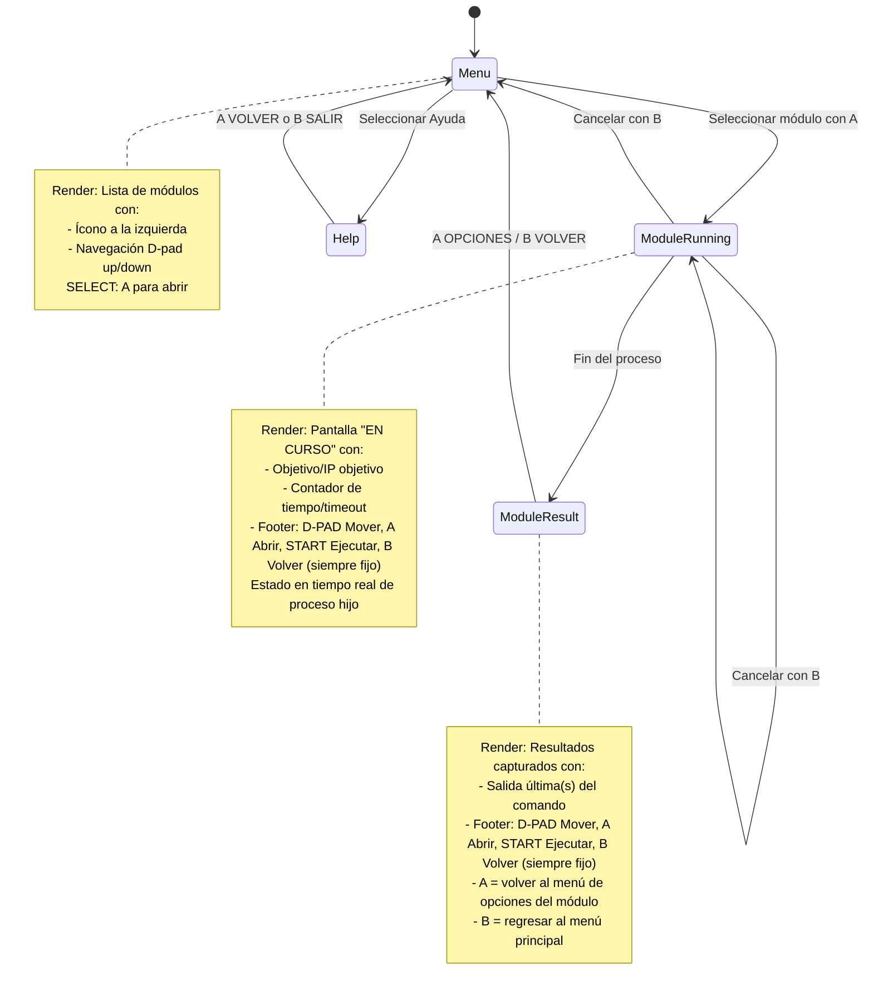

# HunterZeroR - Plan de Modularización

## Arquitectura General

La migración a Rust se realiza **por partes**, manteniendo la compatibilidad total con la interfaz Python existente. El diseño se basa en:

### Capa 1: Rust GUI (hunterzero-rust/)
- Ventana principal 640x480 escalada desde 320x240 virtual
- Manejo de entrada D-pad/A/B/START
- Renderizado con estética pixel-art (Press Start 2P)
- Gestión de estados (menú, módulos, ayuda, configuración, resultados)

### Capa 2: Módulos Python (addons)
- Los módulos originales (`modules/ping/`, `modules/nmap/`, etc.) se mantienen intactos
- Se comunican con Rust a través de **subprocessos** o **Python embebido**
- Cada módulo es independiente y no necesita ser reescrito en Rust a menos que se desee

### Capa 3: Bridge (Comunicación)
- Rust inicia intérprete Python embebido (opcional)
- O bien, Rust lanza `python modules/ping/screen.py` como subprocess
- La salida del módulo Python se muestra en la pantalla Rust
- Los eventos del módulo (fin, cancelación) se reportan de vuelta a Rust

---

## Mapa de Módulos (idéntico a Python)

| ID Módulo | Nombre | Pantalla Python | Funcionalidad |
|---|---|---|---|
| `ping` | PING | `modules/ping/screen.py` | ICMP Echo requests manuales |
| `nmap` | NMAP | `modules/nmap/screen.py` | Escaneo de puertos TCP |
| `nslookup` | NSLOOKUP | `modules/nslookup/screen.py` | Resolución DNS interactiva |
| `bleeding` | BLEEDING | `modules/bleeding/screen.py` | Bluetooth scanning/deauth |
| `system_monitor` | MONITOR | `modules/system_monitor/screen.py` | Métricas CPU/memoria/temp |
| `proc_monitor` | PROC MONITOR | `modules/proc_monitor/screen.py` | Lista de procesos activos |
| `update` | ACTUALIZAR | `core/ui/update_screen.py` | Git pull y actualización |

---

## Flujo de Interfaz (Estado Machine)



---

## Diseño Visual (Mockup Pantalla 320x240)

### Menú Principal

```
+----------------------------------------+
|  ⎋     ⎊     ℹ    |  (3 íconos en header, SIN texto) |
|                    |                                    |
|                    |  (área usable: 200px de altura, Y=20 a Y=219) |
|                    |                                    |
|                    |                                    |
+----------------------------------------+
| D-PAD Mover  A Abrir  START Ejecutar  B Volver |  (footer FIXTO, 20px, siempre igual) |
+----------------------------------------+
```

**Notas:**
- ❌ **SIN título "HUNTERZERO"** en el header
- ❌ **SIN nombres de módulo** ([PING], [NMAP], etc.) en el header
- ✅ SÓLO 3 íconos en el header: ⎋ (red), ⎊ (sistema), ℹ (ayuda)
- ✅ Footer siempre igual: 4 hints fijos en x=4, 116, 188, 272

### Módulo PING - Fase CONFIGURAR

```
+----------------------------------------+
|                                        |
|  IP: 192.168.1.1                        |
|  PAQUETES: 2                            |
|                                        |
|  Ajusta parámetros con D-pad         |
| LEFT/RIGHT: Cambiar IP                |
| UP/DOWN: Cambiar paquetes             |
| A: GUARDAR                            |
+----------------------------------------+
```

### Módulo PING - Fase EJECUTAR (EN CURSO)

```
+----------------------------------------+
|                                        |
|  Módulo: PING                           |
|  Objetivo: 192.168.1.1                   |
|                                        |
|   [     |   ]  Procesando...           |
|                                        |
|  D-PAD Mover  A Abrir  START Ejecutar  B Volver |
+----------------------------------------+
```

### Módulo PING - Fase RESULTADO

```
+----------------------------------------+
|                                        |
|  64 bytes from 192.168.1.1: icmp_seq=1  |
|  ttl=64 time=12.3 ms                    |
|                                        |
|  D-PAD Mover  A Abrir  START Ejecutar  B Volver |
+----------------------------------------+
```

### Pantalla de Ayuda

```
+----------------------------------------+
|             AYUDA PING                |
|----------------------------------------|
|                                        |
|  IP DESTINO: D-pad mueve entre digitos |
|  y cambia su valor.                     |
|                                        |
|  D-pad: mover cursor                    |
|  A: seleccionar                         |
|  DEL: borrar                            |
|  B: cancelar                            |
|  START: validar                         |
|                                        |
|  ARR/ABA TEXTO  A VOLVER    B SALIR     |
|                                        |
|  D-PAD Mover  A Abrir  START Ejecutar  B Volver |
+----------------------------------------+
```

---

## Comunicación Rust ↔ Python

### Opción A: Subprocessos (Recomendado para empezar)

```rust
// En main.rs, al presionar "A" sobre un módulo:
fn start_module_subprocess(module_id: &str) {
    let module_path = match module_id {
        "ping" => "python modules/ping/screen.py",
        "nmap" => "python modules/nmap/screen.py",
        // etc.
        _ => return,
    };
    
    // Lanzar proceso con timeout
    let child = std::process::Command::new("python")
        .args(["-u", module_path])
        .stdin(std::process::Stdio::piped())
        .stdout(std::process::Stdio::piped())
        .stderr(std::process::Stdio::piped())
        .spawn()
        .expect("Failed to start module");
    
    // Leer salida mientras el proceso corre
    // Actualizar pantalla Rust con los resultados
    // Cuando child.wait() termine, regresar al menú
}
```

### Opción B: Python Embebido (pyembed crate)

```toml
# Agregar a Cargo.toml
pyembed = "0.4"

# En main.rs
use pyembed::init_python;
use pyembed::PyThreadState;

fn main() {
    // Inicializar Python embebido
    let py = init_python()?;
    
    // Cargar el módulo hunterzero original
    py.run("import sys; sys.path.insert(0, 'core')")?;
    py.run("from main import HunterZeroApp")?;
    // ... etc
}
```

### Opción C: Módulos puros en Rust (futuro)

Reescribir gradualmente módulos en Rust cuando haya tiempo:
- `modules/ping/ → hunterzero_rust/src/modules/ping.rs`
- Reutilizar la lógica `build_ping_command`, `PACKET_COUNTS`, etc.
- Ventaja: mejor performance, desventaja: mucho trabajo inicial

---

## Requerimientos Técnicos

### Dependencias Rust (Cargo.toml)

```toml
[dependencies]
# Motor gráfico principal
ggez = "0.8"         # Framework 2D simple, usa SDL2 atrás
ggez::graphics = "0.8"
ggez::input = "0.8"
ggez::event = "0.8"

# Soporte para fuentes TTF (Press Start 2P)
sdl2::ttf = "2.8"    # Para cargar .ttf files

# GPIO para botón shutdown físico (opcional)
rppal = "1.5"        # Raspberry Pi GPIO crate

# Python embebido (si se usa la Opción B)
pyembed = "0.4"

# Para tiempos y procesos
timeout = "0.2"      # Para timeouts controlados
```

### Estructura de Recursos

```
hunterzero-rust/
├── Cargo.toml
├── src/
│   └── main.rs       # Código principal
├── assets/
│   ├── fonts/
│   │   └── PressStart2P-Regular.ttf  # Mismo que Python
│   ├── icons/
│   │   ├── ping.png
│   │   ├── nmap.png
│   │   └── (otros iconos de módulos)
│   └── configs/     # Cualquier config adicional
└── modules/         # Opcional: módulos Python embebidos
    └── (mismos módulos del proyecto original)
```

### Configuración para Raspberry Pi Zero W

Ejecutar con variables de entorno adecuadas:

```bash
# En el script de lanzamiento o cargo run
SDL_VIDEODRIVER=kmsdrm
HUNTERZERO_FULLSCREEN=1
```

O en `Cargo.toml` / configuración de build:

```toml
[build]
# No hay build scripts complejos, solo pasar env vars
```

---

## Migración Gradual Recomendada

### Fase 1: Prototipo (Semana 1-2)
- [x] Crear `hunterzero-rust` con ventana ggez básica
- [x] Dibujar menú principal con 6 módulos
- [x] Manejo de entrada teclado (mapear después a gamepad)
- [x] Lanza `python modules/ping/screen.py` como subprocess al presionar A

### Fase 2: Integración Básica (Semana 3-4)
- [ ] Todas las flechas del menú navegan correctamente
- [ ] Abrir módulo PING muestra contenido en área usable (Y=20 a Y=219)
- [ ] B regresar funciona en todas las pantallas
- [ ] Footer hints consistentes con DISEÑO_INTERFAZ.md (siempre los mismos 4 hints)

### Fase 3: Módulos Complejos (Semana 5-8)
- [ ] Módulo NMAP con selección de puertos
- [ ] Módulo BLEEDING con opciones de scanning
- [ ] Módulo NSLOOKUP con editor de dominio

### Fase 4: Optimización (Semana 9+)
- [ ] Migrar módulos críticos a Rust puro si se desea
- [] Optimizar rendering en Pi Zero W
- [] Probar en hardware real

---

## Compatibilidad con Python Existente

**Lo que NO cambia:**
- `modules/` - scripts Python originales permanecen tal cual
- `deploy/` - scripts de instalación systemd/config.txt
- `config/` - settings.example.json y settings.json
- `deploy/install.sh` - instalación en Raspberry Pi
- `requirements.txt` - dependencias Python
- `core/` - la mayor parte permanece igual

**Lo que SÍ cambia:**
- Punto de entrada: En lugar de `python main.py`, se usa `cargo run --release` (después compilado)
- Interfaz visual: Nueva pero idéntica estéticamente
- Comunicación módulos: Subprocessos Python en lugar de pygame directo

---

## Próximos Pasos Inmediatos

1. **Probar compilación en PC**: `cargo build --release` en tu computadora (no en Pi aún)
2. **Conectar inputs**: Mapear teclas del teclado a D-pad/A/B/START
3. **Lanzar primer módulo**: Ver que al presionar "A" se ejecute `python modules/ping/screen.py`
4. **Mostrar salida**: Capturar stdout del proceso Python y dibujarlo en la pantalla Rust

¿Te gustaría que avance con algún aspecto en particular, o prefieres que modifique algo en el diseño actual?